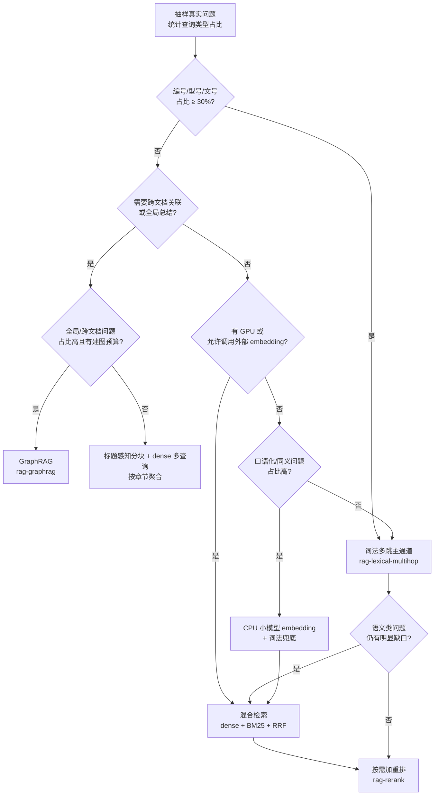
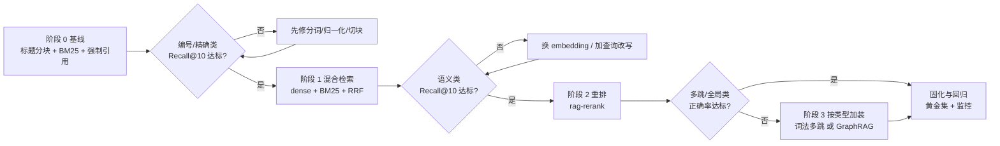

# rag-selection：RAG 技术选型

## 通用原则（不限语言/框架）

**选型从约束出发，不从技术热度出发。** 先量化四类硬约束与两项成本因子，再匹配能力：

- **数据规模**决定索引与检索组件的档位，不要用“未来可能增长”当理由提前上重型组件（YAGNI）；
- **硬件**决定 embedding / rerank 能否本地跑，以及建库是一次性成本还是持续成本；
- **部署与合规**是硬约束（一票否决项）：数据不出域、纯离线、信创环境会直接排除一批方案；
- **查询类型**决定检索通道：编号精确、单点事实、同义语义、跨文档多跳、全局总结，各自对应不同模块；
- **没有单一最优架构**，只有约束下的最优解；默认终局是混合检索，不是某一种“先进”方案；
- **用自有 POC 复测替代厂商口径**，任何 benchmark 都要换算到自己的语料、硬件和问题分布。

## 一、先量化四类硬约束与两项成本因子（选型前置）

抽样 50~100 条真实问题 + 盘点语料，填完下表再谈架构：

| 类型 | 维度 | 要回答的问题 | 分档参考 |
| --- | --- | --- | --- |
| 硬约束 | 文档规模 | 多少份文档？切块后多少 chunk？ | 小 <5k chunk；中 5k~100k；大 >100k |
| 硬约束 | 硬件 | 有无 GPU？内存？是否国产芯片/信创？ | 无 GPU / 单卡 16~24G / 服务端多卡 |
| 硬约束 | 部署合规 | SaaS / 私有化内网 / 纯本地？数据能否出域？ | 不出域、纯离线是硬约束 |
| 硬约束 | 查询类型 | 五类问题各占多少？ | 编号精确 / 单点事实 / 同义语义 / 跨文档多跳 / 全局总结 |
| 成本因子 | 更新频率 | 一次性导入 / 周月更新 / 每日 / 实时 | 低频可全量重建；高频需增量 upsert 与删除 |
| 成本因子 | 运维能力 | 团队能否维护向量库、ES、图谱管线？ | 组件越少越好 vs 有专职平台团队 |

> 决策树只走四类硬约束；更新频率与运维能力是**修正项**——高频更新会否决“全量重建”方案，运维能力弱会否决多组件架构。它们影响实现方式，不改变主分支。
>
> 规模用 **chunk 数**而非文档数更准：一份文档通常切出 20~100 个 chunk。中文没有分词依赖时可用 bigram 估算索引体积。

## 二、决策树（Mermaid）



读图要点：

- **先判查询类型，再判硬件**：编号占比高时，词法多跳是主通道，向量只是兜底；反过来先上向量会走弯路；
- **GraphRAG 的门槛是“全局/跨文档问题占比 + 建图预算”**，文档量与 chunk 数只影响成本估算，不单独构成分支条件；小语料上图谱几乎都是负收益；
- **无 GPU 不等于不能用语义检索**：CPU 小模型 embedding 可用，但要接受建库耗时与并发限制；实在不行就走纯词法 + 查询改写（改写需本地小模型或规则归一化，纯离线且无模型时只能做规则归一化）；
- **图中的 30%、后文的 15% 都是启发式起点**，不是通用常数，须用自有问题分布校准。

## 三、方案矩阵（约束 → 推荐）

| 场景 | 索引 / 存储 | 检索 | 生成增强 | 复杂度 | 主要风险 |
| --- | --- | --- | --- | --- | --- |
| 个人/小团队，<5k chunk，低频更新 | SQLite FTS5 或 LanceDB/Chroma | BM25；按需加 CPU 小模型 dense | 强制引用 | 低 | 语义泛化弱 |
| 部门级，5k~100k，私有化 | PG + pgvector + tsvector/pg_trgm（一套库双通道） | dense + BM25-like + RRF | 加重排、缺失知识检测 | 中 | 索引调优、中文分词 |
| 企业级，>100k，高频更新 | Qdrant/Milvus + ES/OpenSearch | 混合检索 + 重排服务 | 缓存、多查询、按需图谱 | 高 | 运维与一致性 |
| 编号/文号密集（任意规模） | 倒排索引为主 | 词法多跳 + 同义兜底 | 证据链溯源 | 低~中 | 断链、同义改写弱 |
| 无 GPU / 信创 / 纯离线 | FTS5 或 PG 全文 | BM25 + 词法多跳 | 引用 + 降级回答 | 低 | 语义能力受限；生成需本地 LLM |
| 全局总结/多角度问题占比高 | 上述 + 图谱或章节摘要 | dense 多查询 / 图谱聚合 | 社区摘要 | 高 | 建图成本与时效 |

> PG 的 `ts_rank` / `pg_trgm` 不是严格意义上的 BM25（`pg_trgm` 是三元组相似度），可视为 BM25-like 词法通道；需要严格 BM25 时用 ES/OpenSearch、Tantivy 等专用引擎。

**默认推荐**：5k~100k 的部门级场景优先用 PG 一套库解决双通道（少一个组件就少一半运维）；<5k 的个人/小团队仍从 FTS5 起步；大规模再拆向量库与全文检索；不要为了“架构先进”同时维护三套存储。

**成本估算（数量级判断，不写死单价）**：

```
建库成本 ≈ chunk 数 × 平均 token 数 × embedding 单价   （词法路线此项≈0，只剩解析 + 分词 + 索引）
查询成本 ≈ (1 + Σ 每跳桥接词数) × 单次检索开销         （默认每跳 5 词、3 跳 ≈ 16 次检索，而非 4 次）
运维成本 ≈ 组件数 × 人力 + 索引重建频率
```

## 四、硬件档位与模型选择

| 硬件环境 | embedding 建议 | rerank | 注意事项 |
| --- | --- | --- | --- |
| 无 GPU，8C16G | 小维度中文模型（如 512 维级）ONNX/int8，batch 16~32，并发 1 | 先不上，或用轻量交叉编码器 | CPU 并发常无增益；大文档全量重建要排队 |
| 单卡 16~24G | 中等维度多语模型，FP16，batch 64~128 | 可上本地 reranker | 显存与 batch 要压测，避免 OOM |
| 服务端多卡 | 大维度模型或 embedding API | 独立 rerank 服务 | 关注限流、重试与成本 |
| 国产芯片/信创 | 先验证 ONNX / llama.cpp 支持矩阵 | 暂缓 | 优先词法路线，语义能力按实测降级 |

**判断口径**：embedding 的隐性成本在“重建索引”，不在单次查询。文档高频更新且无 GPU 时，词法路线的总成本通常更低。

## 五、选型评分卡（可执行）

| 维度 | 权重 | 评分 1~5 | 判定依据 |
| --- | --- | --- | --- |
| 查询类型匹配 | 30% | | 五类问题的 Recall@10 / 正确率 |
| 硬件与部署可行 | 25% | | 能否在目标环境跑通，是否出域 |
| 建库与更新成本 | 15% | | 首次建库耗时、增量更新难度 |
| 查询延迟与并发 | 15% | | P95 延迟、并发下的退化 |
| 运维复杂度 | 10% | | 组件数、团队熟悉度 |
| 可解释与合规 | 5% | | 证据链、审计要求 |

**硬约束先筛，再打分**：数据不出域、纯离线、延迟上限、信创要求，任一不满足直接淘汰，不进入加权评分。

## 六、分阶段落地路线（Mermaid）

不要一次上全套。每阶段设**退出条件**，达标才进入下一阶段：



阶段退出条件建议（用自有黄金集校准，不要照搬）：

- 阶段 0：编号/精确类 Recall@10 ≥ 0.9，答案引用完整；
- 阶段 1：语义类 Recall@10 ≥ 0.8，P95 延迟满足交互要求；
- 阶段 2：重排后 top-5 正确率有可测提升，且延迟增量可接受；
- 阶段 3：多跳/全局类相对基线的胜出率显著为正，否则回退，不保留“好看但无用”的组件。

## 七、常见误选（反模式）

- **小语料上 GraphRAG**：建图成本远大于收益；全局问题占比低（经验起点约 15%，需用自有数据校准）时基本不划算，该数字不是收益阈值；
- **无 GPU 硬上大维度 embedding**：建库数小时、更新即灾难，最后被迫降级；
- **只上向量不做 keyword**：编号、型号、文号搜不准，一线用户第一个投诉；
- **只上 BM25 做口语化问答**：换个说法召回直接归零；
- **为“先进”堆多轮检索/多智能体**：没有评估集，无法证明收益，只增加延迟与故障面；
- **用厂商 benchmark 代替 POC**：语料、分词、硬件都不同，结论不可迁移；
- **忽视增量删除**：向量库有、元数据没了，检索出“幽灵段落”；
- **中文不做分词与归一化**：全半角、大小写、连字符不一致，精确匹配失效。

## 八、POC 验收清单

- [ ] 黄金集：50~100 条真实问题，按五类分桶，标注证据段落；
- [ ] 至少对比 2 套架构（如 BM25-only vs 混合检索），同语料同硬件；
- [ ] 指标：Recall@10、MRR、端到端正确率、P95 延迟、建库耗时、单查询成本；
- [ ] 分桶报告：编号/语义/多跳/全局分别看，禁止只报总分；
- [ ] 记录失败样例与断链原因，作为下一阶段输入；
- [ ] 厂商/文章中的数字单独列一栏，标注“未验证”，不进入决策。

## 九、与模块的衔接

| 选型结论 | 后续阅读 |
| --- | --- |
| 分块、元数据、批量嵌入与入库 | `rag-ingestion` |
| dense + BM25 双通道与 RRF | `rag-retrieval` |
| 候选集大、需要精排 | `rag-rerank` |
| 编号密集、低算力、强可解释 | `rag-lexical-multihop` |
| 跨文档 / 全局总结 | `rag-graphrag` |
| 查询不完整、口语化 | `rag-query` |
| 引用约束与缺失知识降级 | `rag-generation` |
| 黄金集、指标与回归 | `rag-evaluation` |
